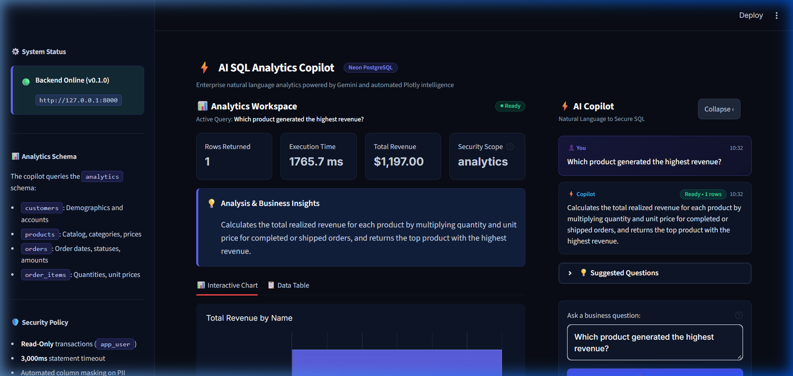
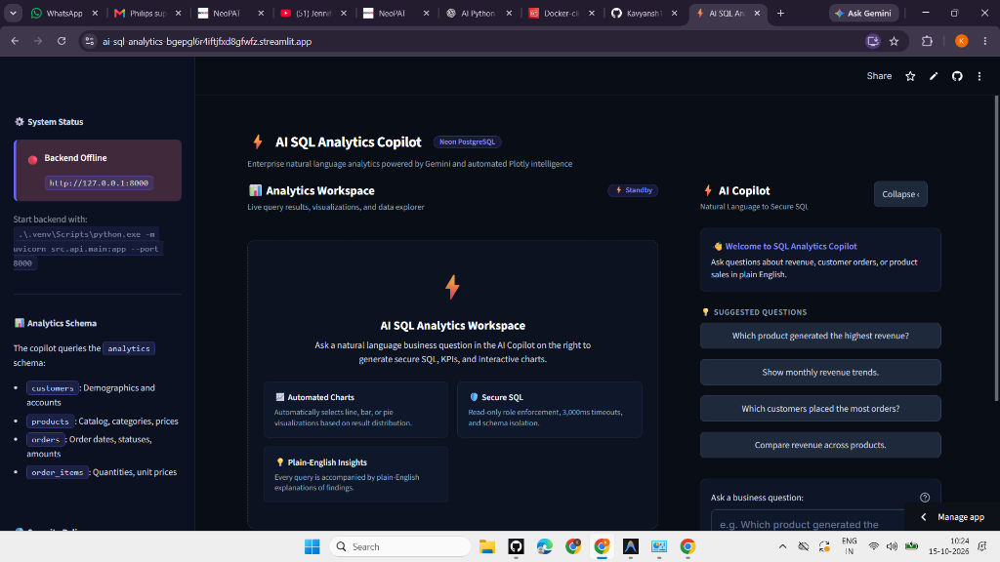
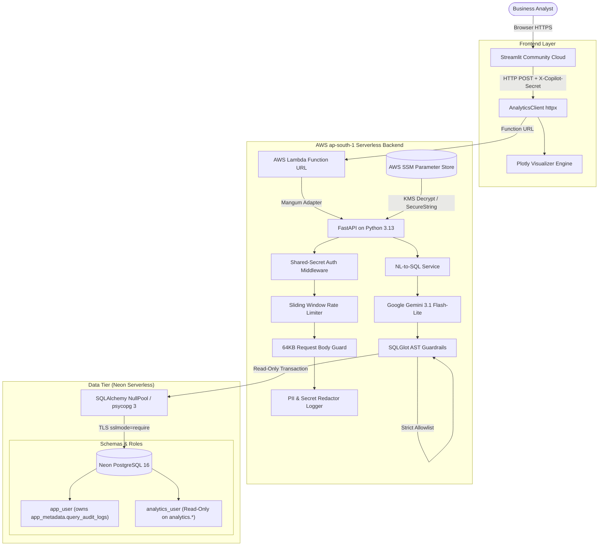

# ⚡ AI-Powered SQL Analytics Copilot

[](https://www.python.org/)
[](https://fastapi.tiangolo.com/)
[-4169E1?style=for-the-badge&logo=postgresql&logoColor=white)](https://neon.tech/)
[](https://aws.amazon.com/lambda/)
[](https://streamlit.io/)
[](https://aistudio.google.com/)
[](tests/)
[](LICENSE)

An enterprise-grade, portfolio-ready **Natural Language to SQL Analytics Copilot** engineered for high performance, serverless scalability, and strict zero-trust security. 

Built with **Python 3.13**, **PostgreSQL 16 (Neon Serverless)**, **SQLAlchemy 2.x (psycopg 3)**, **SQLGlot AST validation**, **Google Gemini 3.1 Flash-Lite**, **AWS Lambda container images**, and a responsive **Streamlit** dark-mode analytics workspace.

---

## 🚀 Live Demo & Endpoints

| Service | Provider / Target | Live Link | Status |
| :--- | :--- | :--- | :--- |
| **Frontend Dashboard** | Streamlit Community Cloud | [**Launch Live Dashboard**](https://ai-sql-analytics-bgepgl6r4iftjxd8gfwfz.streamlit.app/) | 🟢 **Live & Connected** |
| **Backend API** | AWS Lambda Function URL (`ap-south-1`) | `https://ziwyxhciaj2t3knq2o6npetyea0vgimh.lambda-url.ap-south-1.on.aws` | 🟢 **Active** (`AuthType=NONE`, `X-Copilot-Secret` Enforced) |
| **Cloud Database** | Neon Serverless PostgreSQL | `neondb` on AWS `ap-south-1` (`sslmode=require`) | 🟢 **Connected** |
| **GitHub Repository** | Public Source Code | [**Kavyansh180/ai-sql-analytics**](https://github.com/Kavyansh180/ai-sql-analytics) | 🟢 **Main Branch** |

---

## 📸 Workspace & Results Showcase

### 1. Natural Language Analytics & Interactive Visualizations
The split-screen workspace renders real-time business insights, calculated KPIs, automated Plotly charts, transparent SQL generation metadata, and a conversational copilot panel.



### 2. Streamlit Community Cloud Workspace Overview
Production interface featuring dark-mode glassmorphism, instant question suggestions, live system status monitoring, and defense-in-depth policy scope cards.



---

## 🏛️ System Architecture



---

## 🛡️ Defense-in-Depth Security Matrix

The system enforces security at **every layer** of the request lifecycle:

### 1. Dual-Layer Zero-Trust Database Isolation
- **Role-Based Privilege Separation**:
  - `app_user`: Service role that owns the `app_metadata` schema (DDL migrations and query audit logging).
  - `analytics_user`: Restricted read-only role used for all copilot query executions against `analytics.*`.
- **Database Engine Invariants**:
  - `default_transaction_read_only = 'on'` enforced on the role.
  - `statement_timeout = 3000ms` hard execution cap enforced by PostgreSQL.
  - `REVOKE TEMPORARY ON DATABASE` from `PUBLIC` and `analytics_user` (blocks temp table attacks).
  - `REVOKE EXECUTE ON FUNCTION pg_catalog.set_config` from `PUBLIC` and `analytics_user` (prevents session timeout overrides).
  - `public` schema has `REVOKE CREATE` and `REVOKE ALL` from all roles.
  - `app_metadata` schema is strictly isolated (`analytics_user` receives immediate PostgreSQL `permission denied`).
- **Column-Level Security (CLS)**:
  - Direct `SELECT` privileges are granted strictly on approved columns.
  - Sensitive columns (`customers.email`) are blocked at **both** the AST parser and database engine level.

### 2. SQLGlot AST Query Guardrails
- **Statement Count**: Exactly one statement allowed; query chaining with `;` is rejected immediately.
- **Read-Only Shapes**: Only `SELECT`, `UNION`, `INTERSECT`, `EXCEPT`, and `WITH ... SELECT` (CTEs) permitted.
- **Catalog Allowlist**: Referenced tables must match the approved business schema (`customers`, `products`, `orders`, `order_items`).
- **Dangerous Functions**: Blocked at AST inspection (`set_config`, `pg_sleep`, `pg_read_file`, `dblink`, `query_to_xml`, `pg_terminate_backend`).
- **Row Clamp Invariants**: Queries without `LIMIT` or with limits exceeding 1,000 rows are automatically clamped (`MAX_QUERY_ROW_LIMIT = 1000`).

### 3. API & Cloud Infrastructure Security
- **Fail-Closed Shared-Secret Auth**: Unauthenticated requests to protected endpoints receive HTTP `401 Unauthorized` before invoking the LLM or touching the database.
- **AWS SSM Parameter Store Standard SecureString**: All secrets (`COPILOT_API_SECRET`, Neon credentials, Gemini API key) are fetched directly over TLS using `alias/aws/ssm` and cached in memory. Zero `.env` files are stored in Docker layers or Git.
- **Least-Privilege IAM Execution Role**: `sql-analytics-lambda-exec-role` is restricted to CloudWatch logging, reading its single SSM parameter, and decrypting via SSM. Zero administrative permissions.
- **Automated PII/Secret Redaction**: Structured JSON logging scrubs API keys, database passwords, bearer tokens, customer email addresses, and incoming auth headers.
- **Sliding-Window Rate Limiter**: 60 requests/minute per client IP with automatic TTL cleanup.
- **Pure ASGI Request Body Guard**: Enforces a strict 64 KB payload cap before parsing JSON into memory.

---

## 📊 Analytics Schema Catalog

The Copilot generates queries exclusively against the **`analytics`** schema:

| Table | Description | Key Business Columns | Security Policy |
| :--- | :--- | :--- | :--- |
| **`analytics.customers`** | Customer demographic and account data | `id`, `first_name`, `last_name`, `country`, `city`, `created_at` | 🔒 `email` blocked via CLS and AST guard |
| **`analytics.products`** | Catalog items, categories, and unit pricing | `id`, `name`, `category`, `price`, `created_at` | Read-only |
| **`analytics.orders`** | Customer purchase transactions and statuses | `id`, `customer_id`, `order_date`, `status`, `total_amount` | Read-only |
| **`analytics.order_items`** | Line-item order breakdown and quantities | `id`, `order_id`, `product_id`, `quantity`, `unit_price` | Read-only |

Audit records are isolated in **`app_metadata.query_audit_logs`**, inaccessible to the analytics role.

---

## 📈 Automated Plotly Visualization Engine

The frontend includes an intelligent chart selection algorithm that inspects returned query metadata without requiring manual configuration:

- **Line Chart (`px.line`)**: Automatically triggered when temporal columns (`order_date`, `created_at`, months, dates) appear with numeric metrics.
- **Bar Chart (`px.bar`)**: Selected for categorical comparisons (e.g. revenue by category, sales by product, orders by status).
- **Pie / Donut Chart (`px.pie`)**: Triggered for proportional distributions with $\le 7$ unique non-negative categories.
- **KPI Summary Cards**: Automatically extracts total revenue, primary metrics, record counts, and PostgreSQL query execution latency.
- **Interactive Data Table**: Searchable, sortable interactive DataFrame view.

---

## 📁 Repository Structure

```
d:/AI SQL ANALYTICS/
├── .github/                        # Workflows and templates
├── alembic/                        # Database migration scripts (app_metadata schema)
│   ├── env.py                      # Alembic environment configured for app_user
│   └── versions/                   # Versioned DDL migrations
├── docker/
│   ├── postgres/init/
│   │   ├── 01_init_roles_and_schemas.sql   # Idempotent role creation, schemas, and privileges
│   │   ├── 02_seed_business_data.sql       # Realistic e-commerce dataset
│   │   └── 03_column_security_grants.sql   # Column-level SELECT grants
│   ├── requirements-api.txt        # Containerized backend dependencies
│   └── requirements-frontend.txt   # Containerized frontend dependencies
├── docs/
│   └── screenshots/                # High-resolution dashboard showcase images
├── scripts/
│   └── init_remote_neon.py         # Remote cloud database bootstrapping script
├── src/
│   ├── api/                        # FastAPI REST application
│   │   ├── auth.py                 # Fail-closed X-Copilot-Secret header authentication
│   │   ├── handler.py              # AWS Lambda Mangum entry point
│   │   ├── main.py                 # FastAPI app factory, liveness, & readiness probe
│   │   ├── middleware.py           # 64KB body guard, request correlation ID, structured logs
│   │   ├── rate_limiter.py         # Sliding window in-memory rate limiter with TTL pruning
│   │   ├── routes.py               # REST route: POST /api/v1/analytics/query
│   │   └── schemas.py              # Request/response DTOs with question validation
│   ├── core/                       # Core configuration and logging
│   │   ├── config.py               # Pydantic Settings & AWS SSM Parameter Store loader
│   │   └── logging.py              # Structured JSON formatter & PII/secret redactor
│   ├── db/                         # SQLAlchemy 2.x & Database Connectivity
│   │   ├── models/                 # DeclarativeBase, business, and metadata models
│   │   └── session.py              # Role-specific connection engines (NullPool serverless)
│   ├── frontend/                   # Streamlit Frontend
│   │   ├── app.py                  # Responsive dark-mode analyst UI & copilot panel
│   │   ├── charts.py               # Automated Plotly chart generator
│   │   └── client.py               # HTTP client with cold-start resilience & deduplication
│   ├── llm/                        # Google Gemini AI Integration
│   │   ├── models.py               # Pydantic structured output models
│   │   ├── prompts.py              # Versioned system prompt with safety constraints
│   │   ├── provider.py             # Gemini provider with backoff retries & jitter
│   │   ├── schema_context.py       # Grounded database catalog and schema metadata
│   │   └── service.py              # NL-to-SQL orchestration pipeline
│   └── security/                   # SQL Validation & Column Security
│       ├── policy.py               # Centralized column allowlists and drift detection
│       └── validator.py            # SQLGlot AST guardrails, function blocks, limit clamp
├── tests/                          # 309 Passing Pytest Suite
│   ├── test_api_endpoints.py       # Endpoint status, headers, and validation
│   ├── test_column_security.py     # 70 adversarial AST and DB column security tests
│   ├── test_frontend_charts.py     # Automated chart selection unit tests
│   ├── test_frontend_client.py     # Client deduplication, errors, and cold-start tests
│   ├── test_lambda_and_serverless.py# Mangum handler, NullPool, and SSL mode tests
│   ├── test_production_readiness.py# Rate limiting, body limits, redaction, and retries
│   ├── test_shared_secret_auth.py  # Fail-closed header auth tests
│   ├── test_sql_validator.py       # SQLGlot AST guardrail and injection tests
│   └── test_ssm_config.py          # SSM JSON configuration parser and invariant tests
├── .dockerignore                   # Docker build context exclusions
├── .gitignore                      # Strict Git exclusion (.env, secrets, venv)
├── AWS_DEPLOYMENT_RUNBOOK.md       # Step-by-step production AWS runbook
├── Dockerfile                      # Multi-stage production container
├── Dockerfile.frontend             # Streamlit container build definition
├── Dockerfile.lambda               # AWS Lambda Python 3.13 OCI container image
├── docker-compose.yml              # Local PostgreSQL 16 development environment
├── docker-compose.prod.yml         # Production container stack
├── pyproject.toml                  # Project packaging and pytest configuration
└── requirements.txt                # Unified project dependencies
```

---

## 🛠️ Local Development Setup

### Prerequisites
- **Python 3.13+**
- **Docker Desktop** (for local PostgreSQL 16)
- **Google Gemini API Key** (free tier available at [Google AI Studio](https://aistudio.google.com/))

### 1. Clone & Setup Virtual Environment
```powershell
git clone https://github.com/Kavyansh180/ai-sql-analytics.git
cd ai-sql-analytics

python -m venv .venv
.\.venv\Scripts\Activate.ps1
pip install -r requirements.txt
```

### 2. Configure Environment
Copy `.env.example` to `.env`:
```powershell
Copy-Item .env.example .env
```
Provide your `GEMINI_API_KEY` in `.env`.

### 3. Start Local PostgreSQL Database
```powershell
docker compose up -d
```
Docker initializes PostgreSQL 16 with role segregation (`app_user`, `analytics_user`), schemas (`analytics`, `app_metadata`), and sample business data.

### 4. Run Alembic Database Migrations
```powershell
.\.venv\Scripts\alembic upgrade head
```

### 5. Launch the Backend API & Streamlit Dashboard
Open two separate terminal windows:

**Terminal 1 (FastAPI Backend):**
```powershell
.\.venv\Scripts\python.exe -m uvicorn src.api.main:app --port 8000 --reload
```

**Terminal 2 (Streamlit Frontend):**
```powershell
.\.venv\Scripts\python.exe -m streamlit run src/frontend/app.py
```

Access the local dashboard at: `http://localhost:8501`.

---

## 🧪 Comprehensive Test Suite (309 Tests)

Run the full pytest suite:

```powershell
.\.venv\Scripts\python.exe -m pytest tests/ -v
```

### Test Coverage Highlights:
- **`test_column_security.py`**: 70 adversarial AST and database column-level security tests verifying that email and unapproved columns are rejected across subqueries, CTEs, aliases, and direct calls.
- **`test_sql_validator.py`**: Validates blocking of `DELETE`, `DROP`, `UPDATE`, `INSERT`, `ALTER`, `TRUNCATE`, `GRANT`, `SELECT ... INTO`, and dangerous functions (`set_config`, `pg_sleep`, `dblink`).
- **`test_shared_secret_auth.py`**: Confirms production fails closed when `COPILOT_API_SECRET` is unset, and rejects unauthenticated/invalid header requests.
- **`test_production_readiness.py`**: Evaluates 64KB body size limit enforcement, sliding-window rate limiting per IP, structured JSON logging, and exponential retry backoff.
- **`test_lambda_and_serverless.py`**: Verifies Mangum handler compatibility, `NullPool` serverless connection handling, and SSL enforcement.

---

## ☁️ Production Deployment

The project is fully documented for reproducible, zero-downtime deployment:

- **Complete Runbook:** Inspect [**`AWS_DEPLOYMENT_RUNBOOK.md`**](AWS_DEPLOYMENT_RUNBOOK.md) for step-by-step instructions covering:
  - AWS IAM least-privilege role creation (`sql-analytics-lambda-exec-role`).
  - AWS SSM Parameter Store Standard `SecureString` JSON configuration.
  - Amazon ECR private repository provisioning and Docker container push (`--provenance=false`).
  - AWS Lambda Function URL creation with `AuthType=NONE` and October 2025 security model permissions (`lambda:InvokeFunctionUrl` + `lambda:InvokeFunction`).
  - Streamlit Community Cloud deployment and secret injection.
  - CloudWatch log retention (7 days), monthly budget alerts ($2.00), and emergency shutdown procedures.

---

## 📄 License

This project is licensed under the **MIT License** — see the [LICENSE](LICENSE) file for details.
